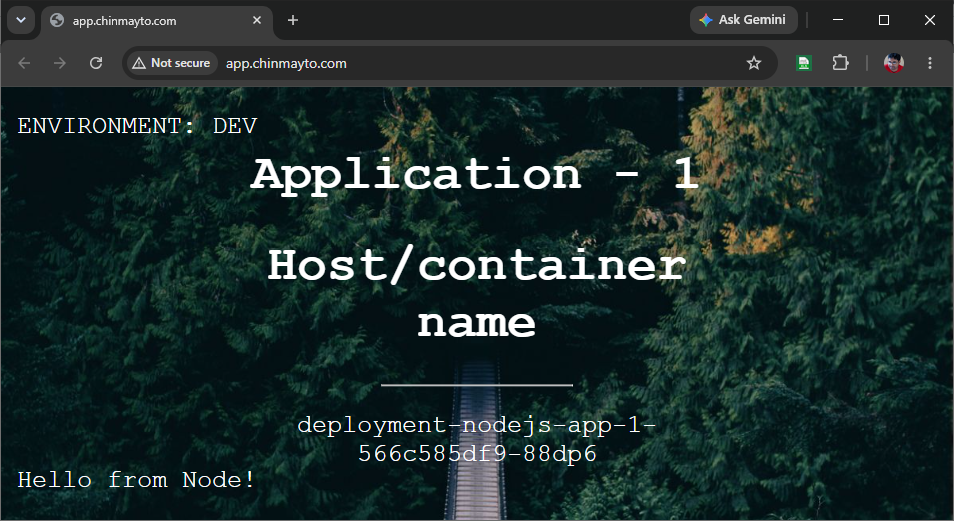
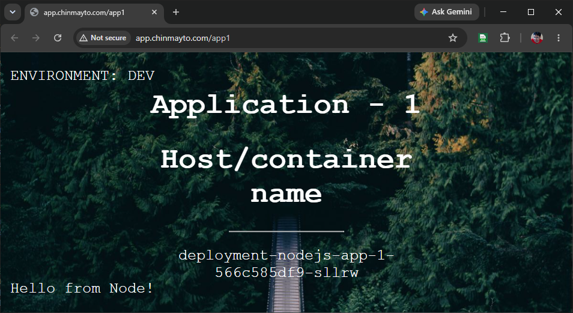
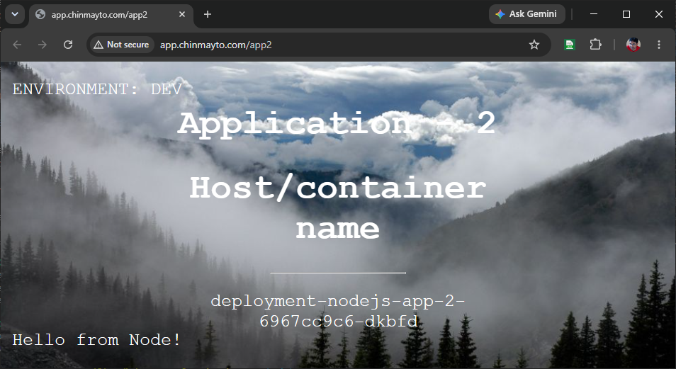

# Routing Traffic on EKS with the F5 NGINX Ingress Controller

If you have run anything on Kubernetes, you have almost certainly used `ingress-nginx` - the community controller that fronts inbound traffic for roughly half of all clusters. That era is ending. In this post we will look at *why* you need to move, and then build a complete, working setup on AWS EKS using the **F5 NGINX Ingress Controller** instead: an EKS cluster provisioned with Terraform, a Network Load Balancer wired up through the AWS Load Balancer Controller, and three flavors of routing (basic, path-based, and host-based) using two sample apps.

## The elephant in the room: ingress-nginx is retired

First, the thing you need to know. The community-maintained **`kubernetes/ingress-nginx`** project (the controller that uses `nginx.ingress.kubernetes.io/` annotations) has been **retired**. The Kubernetes Steering and Security Response Committees announced the retirement in early 2026, after years of warnings that the project badly needed maintainers. Best-effort maintenance wound down around **March 2026**, and after that point there are **no new releases, no bug fixes, and no security patches** - the repository becomes read-only. Existing installs keep running, and the Kubernetes Ingress API itself is unaffected, but running an unpatched, internet-facing proxy is not a position you want to be in.

> Source: the official Kubernetes blog, [Ingress NGINX Retirement: What You Need to Know](https://kubernetes.io/blog/2025/11/11/ingress-nginx-retirement/). Facts rephrased here for compliance.

That leaves teams with a decision. The two mainstream directions are:

1. **Gateway API** - the long-term successor API for L4/L7 routing.
2. **A supported Ingress controller** - most naturally the **F5 NGINX Ingress Controller** (`nginx/kubernetes-ingress`), which is a *different project* from the retired community one. It is actively maintained by F5/NGINX Inc., uses the `nginx.org/` annotation prefix, and ships its own CRDs (`VirtualServer`, `VirtualServerRoute`, `TransportServer`, `Policy`) for advanced traffic management.

| | Community `ingress-nginx` (retired) | F5 NGINX Ingress Controller |
|---|---|---|
| **Status** | Retired, read-only, no patches | Actively maintained |
| **Maintainer** | Kubernetes community | F5 / NGINX Inc. |
| **Helm chart** | `kubernetes.github.io/ingress-nginx` | `oci://ghcr.io/nginx/charts/nginx-ingress` |
| **Annotation prefix** | `nginx.ingress.kubernetes.io/` | `nginx.org/` |
| **Advanced routing** | Annotation-only | `VirtualServer` / `VirtualServerRoute` / `Policy` CRDs |

This post takes direction #2.

## Architecture

Here is what we are building. A single Network Load Balancer sits at the edge; the F5 NGINX Ingress Controller runs behind it as a reverse proxy and routes requests to two sample Node.js apps that live in a shared namespace (`simple-nodejs-app`).

```
                          Internet
                             │
                   DNS (Route 53 alias A)
            app.chinmayto.com / app1.* / app2.*
                             │
                             ▼
              ┌──────────────────────────────┐
              │   AWS Network Load Balancer   │   (provisioned by the
              │        (internet-facing)      │    AWS Load Balancer Controller)
              └──────────────────────────────┘
                             │  target-type: ip
                             ▼
              ┌──────────────────────────────┐
              │  F5 NGINX Ingress Controller  │   namespace: nginx-ingress
              │        (reverse proxy)        │   ingressClassName: nginx
              └──────────────────────────────┘
                   │                      │
        host/path routing rules   host/path routing rules
                   ▼                      ▼
        ┌──────────────────────────────────────────┐
        │          namespace: simple-nodejs-app     │
        │  ┌─────────────────┐  ┌─────────────────┐ │
        │  │  svc + 2 pods   │  │  svc + 2 pods   │ │
        │  │  nodejs-app-1   │  │  nodejs-app-2   │ │
        │  └─────────────────┘  └─────────────────┘ │
        └──────────────────────────────────────────┘
```

Component breakdown:

- **Amazon EKS** - the cluster, provisioned with Terraform (`terraform-aws-modules/eks/aws`), with the `eks-pod-identity-agent` addon enabled.
- **AWS Load Balancer Controller (LBC)** - installed via Helm, granted AWS permissions through **EKS Pod Identity** (no IRSA/OIDC wiring). The LBC watches the NGINX `LoadBalancer` Service and provisions an **IP-target NLB** for it.
- **F5 NGINX Ingress Controller** - installed via Helm into the `nginx-ingress` namespace. Its Service is annotated so the LBC backs it with an NLB:
  - `service.beta.kubernetes.io/aws-load-balancer-type: external`
  - `service.beta.kubernetes.io/aws-load-balancer-nlb-target-type: ip`
  - `service.beta.kubernetes.io/aws-load-balancer-scheme: internet-facing`
- **Route 53** - one alias `A` record per hostname (`app.`, `app1.`, `app2.chinmayto.com`), all pointing at the NLB.
- **Two Node.js apps** - `nodejs-app-1` and `nodejs-app-2`, both in the `simple-nodejs-app` namespace, each a Deployment (2 replicas) fronted by a `ClusterIP` Service.

## Deploy the two apps

Both apps share the `simple-nodejs-app` namespace. `nodejs-app-1` listens on container port 8080, `nodejs-app-2` on 8081; both are exposed internally via a `ClusterIP` Service on port 80.

`deploy-simple-nodejs-app-1.yaml`:

```yaml
---
apiVersion: v1
kind: Namespace
metadata:
  name: simple-nodejs-app
---
apiVersion: apps/v1
kind: Deployment
metadata:
  namespace: simple-nodejs-app
  name: deployment-nodejs-app-1
spec:
  selector:
    matchLabels:
      app.kubernetes.io/name: nodejs-app-1
  replicas: 2
  template:
    metadata:
      labels:
        app.kubernetes.io/name: nodejs-app-1
    spec:
      containers:
      - image: public.ecr.aws/n4o6g6h8/simple-nodejs-app-1:latest
        imagePullPolicy: Always
        name: nodejs-app-1
        ports:
        - containerPort: 8080
        readinessProbe:
          httpGet:
            path: /
            port: 8080
          initialDelaySeconds: 10
          periodSeconds: 10
          failureThreshold: 3
---
apiVersion: v1
kind: Service
metadata:
  namespace: simple-nodejs-app
  name: service-nodejs-app-1
spec:
  type: ClusterIP
  ports:
    - port: 80
      name: http
      targetPort: 8080
  selector:
    app.kubernetes.io/name: nodejs-app-1
```

`deploy-simple-nodejs-app-2.yaml` is the mirror image in the same `simple-nodejs-app` namespace (service `service-nodejs-app-2`, container port 8081).

Apply both:

```bash
kubectl apply -f k8s-manifests/deploy-simple-nodejs-app-1.yaml
kubectl apply -f k8s-manifests/deploy-simple-nodejs-app-2.yaml

kubectl get svc,pod -n simple-nodejs-app
```

## A note that shapes everything: Ingress is namespaced

A key Kubernetes rule drives the manifest design below: **an `Ingress` can only reference Services in its own namespace.** This is why both apps share a single namespace, `simple-nodejs-app`: it lets one Ingress reference both Services and own all the rules for a given host. (Trying to serve the *same host* from two Ingresses in *different* namespaces causes a host collision - the controller accepts one and ignores the other - which is exactly the trap this layout avoids.)

Also note the F5-specific annotation `nginx.org/rewrites` - it rewrites the request URI before forwarding to the backend. It is the F5 equivalent of the retired controller's `nginx.ingress.kubernetes.io/rewrite-target`.

### 1) Basic routing

The simplest case: send everything on a host to one backend. Here all traffic to `app.chinmayto.com` goes to `service-nodejs-app-1`.

`nginx-ingress-basic-routing.yaml`:

```yaml
apiVersion: networking.k8s.io/v1
kind: Ingress
metadata:
  name: simple-nodejs-ingress
  namespace: simple-nodejs-app
  annotations:
    nginx.org/rewrites: "serviceName=service-nodejs-app-1 rewrite=/"
spec:
  ingressClassName: nginx
  rules:
    - host: app.chinmayto.com
      http:
        paths:
          - path: /
            pathType: Prefix
            backend:
              service:
                name: service-nodejs-app-1
                port:
                  number: 80
```

```bash
kubectl apply -f k8s-manifests/nginx-ingress-basic-routing.yaml
kubectl get ingress -n simple-nodejs-app
```

Access it at `http://app.chinmayto.com/`.



### 2) Path-based routing (single Ingress, single namespace)

Route by URL path: `/app1` to one app, `/app2` to the other - both under the same host `app.chinmayto.com`. Because both Services live in one namespace, this is a **single Ingress with two paths**.

There is a catch: the sample apps only serve `/`, so the matched prefix (`/app1`, `/app2`) has to be **stripped** before the request reaches the backend - otherwise the app replies `Cannot GET /app1`. With the F5 NGINX Ingress Controller you strip a prefix using two annotations together:

- `nginx.org/path-regex: "case_sensitive"` - treat the `path` field as a regular expression.
- `nginx.org/rewrite-target: "/$1"` - rewrite the matched URI to `/`, where `$1` is the regex capture group that preserves anything after the prefix.

`nginx-ingress-path-based-routing.yaml`:

```yaml
apiVersion: networking.k8s.io/v1
kind: Ingress
metadata:
  name: simple-nodejs-ingress
  namespace: simple-nodejs-app
  annotations:
    nginx.org/path-regex: "case_sensitive"
    nginx.org/rewrite-target: "/$1"
spec:
  ingressClassName: nginx
  rules:
    - host: app.chinmayto.com
      http:
        paths:
          - path: /app1(?:/(.*))?
            pathType: ImplementationSpecific
            backend:
              service:
                name: service-nodejs-app-1
                port:
                  number: 80
          - path: /app2(?:/(.*))?
            pathType: ImplementationSpecific
            backend:
              service:
                name: service-nodejs-app-2
                port:
                  number: 80
```

```bash
kubectl apply -f k8s-manifests/nginx-ingress-path-based-routing.yaml
kubectl get ingress -n simple-nodejs-app
```

Access `http://app.chinmayto.com/app1` and `http://app.chinmayto.com/app2`.





### 3) Host-based routing (single Ingress, single namespace)

Route by the HTTP `Host` header: `app1.chinmayto.com` to one app, `app2.chinmayto.com` to the other. Since the hosts differ and both Services are in the same namespace, this is a single Ingress with two host rules.

Each host routes `/` straight to its backend, so **no rewrite annotation is needed** - the request path passes through unchanged. (Adding `nginx.org/rewrites` here is unnecessary and, with two services listed, can misroute and produce a 404.)

`nginx-ingress-host-based-routing.yaml`:

```yaml
apiVersion: networking.k8s.io/v1
kind: Ingress
metadata:
  name: simple-nodejs-ingress
  namespace: simple-nodejs-app
spec:
  ingressClassName: nginx
  rules:
    - host: app1.chinmayto.com
      http:
        paths:
          - path: /
            pathType: Prefix
            backend:
              service:
                name: service-nodejs-app-1
                port:
                  number: 80
    - host: app2.chinmayto.com
      http:
        paths:
          - path: /
            pathType: Prefix
            backend:
              service:
                name: service-nodejs-app-2
                port:
                  number: 80
```

```bash
kubectl apply -f k8s-manifests/nginx-ingress-host-based-routing.yaml
kubectl get ingress -n simple-nodejs-app
```

Access `http://app1.chinmayto.com` and `http://app2.chinmayto.com`.


## Testing without DNS

If your Route 53 records are not in place yet, you can still prove the routing works by sending the `Host` header explicitly to the NLB. If this returns your app, the controller and manifests are correct and the only remaining piece is DNS:

```bash
# Grab the NLB hostname
kubectl get svc nginx-ingress-controller -n nginx-ingress

# Hit it with the right Host header
curl -H "Host: app.chinmayto.com" http://<NLB-DNS-NAME>/
```

A plain request to the raw NLB name returns an `nginx` **404** - that is expected. It means the request reached the controller but no rule matched the (wrong) Host header. Point your DNS at the NLB and use the real hostname.

## Cleanup

First remove the application and routing manifests, then tear down the infrastructure.

```bash
# Delete the Ingress + app manifests
kubectl delete -f k8s-manifests/nginx-ingress-basic-routing.yaml
kubectl delete -f k8s-manifests/nginx-ingress-path-based-routing.yaml
kubectl delete -f k8s-manifests/nginx-ingress-host-based-routing.yaml
kubectl delete -f k8s-manifests/deploy-simple-nodejs-app-1.yaml
kubectl delete -f k8s-manifests/deploy-simple-nodejs-app-2.yaml
```

```bash
# Destroy the EKS cluster, controllers, NLB, and Route 53 records
cd infrastructure
terraform destroy
```

## Conclusion

`ingress-nginx` served the community well, but with its retirement it is time to move. The F5 NGINX Ingress Controller is a drop-in-spirited, actively maintained alternative: you keep the familiar Kubernetes `Ingress` resource, swap the annotation prefix to `nginx.org/`, and gain a richer CRD-based API when you need it. In this post we built the whole path end to end on EKS - an IP-target NLB via the AWS Load Balancer Controller, the F5 controller as the edge proxy, and basic, path-based, and host-based routing driven by plain `Ingress` resources in a single namespace. A key lesson along the way: because an `Ingress` can only reference Services in its own namespace, same-host routing is cleanest when the backends share a namespace - which is why both apps live in `simple-nodejs-app`. From here, the natural next steps are TLS termination, authentication, and traffic splitting with the `VirtualServer` CRD (which is also F5's answer to true cross-namespace routing).

## References

- **Companion GitHub repo:** https://github.com/chinmayto/kubernetes-f5-nginx-ingress
- Ingress NGINX Retirement - official Kubernetes blog: https://kubernetes.io/blog/2025/11/11/ingress-nginx-retirement/
- Ingress NGINX statement from the Steering & Security committees: https://kubernetes.io/blog/2026/01/29/ingress-nginx-statement/
- F5 NGINX Ingress Controller docs: https://docs.nginx.com/nginx-ingress-controller/
